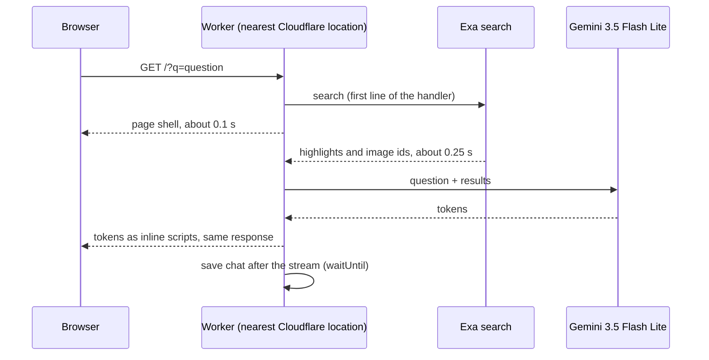

<p align="center"></p>

# Quisk

Formerly QuickAsk.

A fast answer engine that runs on Cloudflare Workers. Set it as your browser's
search engine: every search opens a chat that streams an answer from the web,
with sources and, when they help, pictures.

- Streams the first words of an answer in about 1 second.
- Searches the web with [Exa](https://exa.ai) and answers with Gemini 3.5 Flash Lite.
- Each search is a chat. Previous chats are in the sidebar, one history per account.
- The sidebar updates live across tabs and devices over a hibernating WebSocket.
- Search your chats from the sidebar (keywords across titles and messages, SQLite FTS5); the list loads 50 at a time as you scroll.
- Passkey accounts with a waitlist. People join with their email address and confirm it with a link (sent by
  Cloudflare Email Service). The admin approves them on `/admin`, and they get a link to create a passkey.
  Without a custom domain, a shared access key gates the app and anyone with it can sign up.
- Lost your passkey, or on a new device? Enter your email address on the sign-in page to get a sign-in link, then
  add a passkey for that device.
- Each user can ask 100 questions a day. The admin can change the limit for each user on `/admin`.
- Read-only share links that anyone can open, with no account. Links show a rich preview card on X, iMessage and Slack.
- Press ⌘K (Ctrl K) for a new search.
- Answers know your approximate city and local time (from Cloudflare), so local questions like the weather work.
- Follow-up questions keep the previous answer's search results in context. The model searches again (as a tool)
  only when it needs new facts, and new results are numbered after the earlier ones.
- Each answer ends with three suggested follow-up questions you can tap. Plain URLs and domains in answers are links.
- A faint ⋯ under each answer opens a menu: the raw search results, copy the answer, rerun that answer, share
  just that answer, or continue the chat in Claude, ChatGPT, Grok or Gemini (your own account; the chat is
  prefilled where the service allows it and always copied to the clipboard).
- Exa calls are limited to 10 per second (Cloudflare Rate Limiting, counted per location). Over the limit, a search
  waits up to 3 s, then the model answers without search results.
- The admin sees live costs in the sidebar. `/admin` has the waitlist, daily limits, and costs by user and day.

## How it stays fast



1. One round trip. The search URL returns the page and the streamed answer in the
   same HTTP response. There is no second request from page JavaScript.
2. The search starts before any other work in the handler.
3. Sign-in checks read no storage. The session is an HMAC-signed cookie.
4. Storage is off the critical path. The sidebar loads in parallel. Chats save after
   the stream ends. Follow-ups send the history the browser already has.
5. The request path is a 20 KB Worker. The WebAuthn library loads only on sign-in routes.
6. The model was picked by measured time to first token, with the same search
   results given to each candidate. See [Benchmarks](#benchmarks).

## Install it on your Cloudflare account

### What you need

| Item | Where to get it |
|---|---|
| A Cloudflare account | [dash.cloudflare.com](https://dash.cloudflare.com/sign-up). The free plan is enough. Open **Workers & Pages** once so the account has a `workers.dev` subdomain. |
| A Cloudflare API token | **My Profile → API Tokens → Create Token → Edit Cloudflare Workers** template. For a custom domain, also give it **Zone → DNS: Edit** on that zone. |
| A Gemini API key | [Google AI Studio](https://aistudio.google.com/apikey) |
| An Exa API key | [dashboard.exa.ai](https://dashboard.exa.ai) |
| [Bun](https://bun.sh) 1.2 or later | `curl -fsSL https://bun.sh/install \| bash` |

### Steps

1. Get the code:

   ```sh
   git clone https://github.com/spullara/quickask.git
   cd quickask/app
   ```

2. Put your keys in `app/.env` (git ignores this file):

   ```sh
   cat > .env <<'EOF'
   CLOUDFLARE_API_TOKEN=your-cloudflare-token
   GEMINI_API_KEY=your-gemini-key
   EXA_API_KEY=your-exa-key
   EOF
   ```

3. Deploy:

   ```sh
   ./deploy.sh
   ```

   The script installs the dependencies, creates an access key and a session secret
   in `app/.env`, deploys with [Alchemy](https://alchemy.run), and prints three lines:

   ```
   App:          https://quick-quick-....workers.dev
   First visit:  https://quick-quick-....workers.dev/?k=<access key>
   Search URL:   https://quick-quick-....workers.dev/?q=%s
   ```

4. Open the **First visit** link once in each browser. It stores the access key in a
   cookie. Then create an account with your email address and a passkey.

5. Add the **Search URL** as a search engine (see below).

Give the **First visit** link only to people you want to use your app: each search
costs Gemini and Exa credits.

### Use a custom domain (recommended)

Passkeys are tied to a hostname. Pick the domain before people create accounts.

1. Add the domain to the same Cloudflare account. You can register it there.
2. Add `QUICK_DOMAIN=example.com` to `app/.env`.
3. Run `./deploy.sh` again. Your app is now at `https://example.com`. The
   `workers.dev` address keeps working.

With a custom domain, the deploy turns on Cloudflare Email Sending for it and the app uses a waitlist in place of
the access key. Emails come from `login@<domain>`. This needs the Workers Paid plan, and the token needs
**Zone → Email Sending: Edit** (or create the sender in the dashboard: **Compute → Email Service → Email Sending →
Onboard Domain**).

Set `ADMIN_NAME` to your email address, then join the waitlist with it: the admin's address is approved at once.
To keep the access key and open sign-up instead, add `WAITLIST=off` to `app/.env` and run `./deploy.sh` again.

### Add it to your browser

- **Chrome, Arc, Edge:** Settings → Search engine → Manage search engines and site search →
  Site search → Add. URL: `https://<your app>/?q=%s`. Choose **Make default** to use it
  for every search, or give it a shortcut such as `q`.
- **Firefox:** open your app once, then right-click the address bar and choose
  **Add "Quisk"**.
- **Safari:** Safari has no custom search engines. Use a redirect extension such as
  "Customize Search Engine" with the same URL.

### Settings

`deploy.sh` reads each value from the environment, then `app/.env`, then `~/.env`.

| Name | Needed | Purpose |
|---|---|---|
| `CLOUDFLARE_API_TOKEN` (or `CF_TOKEN`) | yes | Deploys the Worker. |
| `GEMINI_API_KEY` | yes | Writes the answers. |
| `EXA_API_KEY` | yes | Web search and images. |
| `CLOUDFLARE_ACCOUNT_ID` | no | Needed only when the token can see more than one account. |
| `QUICK_DOMAIN` | no | Custom domain, for example `ask.example.com`. |
| `WAITLIST` | no | `off` uses the access key and open sign-up even with a custom domain. |
| `MAIL_FORWARD_TO` | no | With the waitlist: your own address. The domain then receives mail (MX and SPF records), and mail to any address at it is forwarded to you. Spam filters trust a domain that can receive mail more. Confirm the email Cloudflare sends you, then run `./deploy.sh` again. |
| `OLD_DOMAINS` | no | Earlier custom domains, comma separated, after a move to a new `QUICK_DOMAIN`. They keep serving the Worker only to move people: signed-in visitors are handed to the new domain with their page and query, signed-out visitors sign in with their old passkey first, and everything else (share links, email links) redirects. On the new domain, people are offered a new passkey. |
| `DAILY_QUERIES` | no | Questions a day for each user. Default 100. The admin has no limit. |
| `ADMIN_NAME` | no | Account (email address) that can see costs. The oldest account with this name is the admin. |
| `ACCESS_KEY`, `SESSION_SECRET` | created for you | The access key is used only without the waitlist. Change `SESSION_SECRET` to sign everyone out. |

### Keep `app/.alchemy/`

Alchemy keeps its deploy state in `app/.alchemy/` on your machine. Git ignores it.
Without it, Alchemy cannot update or remove what it created. Back it up if you deploy
from more than one machine.

### Remove everything

```sh
./deploy.sh destroy
```

## Test

The end-to-end test runs against your deployed app. It uses a software passkey, so it
needs no browser:

```sh
cd app
python3 -m pip install cryptography
python3 e2e.py https://<your app> "$(grep ^ACCESS_KEY= .env | cut -d= -f2)"
```

It reads `SESSION_SECRET` from `app/.env`. With it, the test gets the email links for its `@example.com` accounts in
the replies and approves them as the admin. It checks the waitlist, approval, daily limits, passkey sign-up and sign-in, streaming, images, separate
histories per account, follow-ups, share links and deletes. It writes `e2e-result.json`.
Each run creates two test accounts (`e2e-alice-<random>@example.com`, `e2e-bob-<random>@example.com`).

## Project layout

```
app/
  alchemy.run.ts     Cloudflare resources: two Workers and four Durable Objects
  deploy.sh          deploy and destroy
  e2e.py             end-to-end test
  src/worker.ts      routes, Exa search, Gemini streaming, Chats and Shares stores
  src/page.ts        HTML, CSS and browser JavaScript (no build step, no framework)
  src/session.ts     signed session cookies
  src/auth.ts        passkey routes (loaded on demand)
  src/auth-store.ts  users, passkeys and the waitlist
  src/waitlist.ts    waitlist emails and admin actions (loaded on demand)
  src/usage.ts       cost ledger and model prices
  src/icons.ts       favicons, generated by icons/build.sh from icons/logo.svg
  src/card.ts        share preview image (separate Worker, so its WebAssembly stays off the search path)
bench.py, ttft.py, answer_eval.py, tool_eval.py   model and search benchmarks
```

Storage is four SQLite-backed Durable Objects: one `Chats` object per user, one
`Auth` object for users and passkeys, one `Shares` object for share links, and one
`Usage` object for the cost ledger.

## Benchmarks

The scripts at the repo root are how the stack was chosen. They read API keys from
`~/.env`.

- `bench.py`: total latency of fast models from Anthropic, Google and OpenAI with
  their built-in web search.
- `ttft.py`: time to first token for the fastest candidates.
- `answer_eval.py`: answer accuracy against first-token time when every model gets the
  same Exa results. Better search context fixed accuracy more than a bigger model did.
- `openrouter_eval.py`: the fastest OpenRouter models (by OpenRouter's own latency figures) against production, with the
  production prompt and the same Exa results. Writes `openrouter_eval.json`.
- `tool_eval.py`: direct search compared with letting the model call search as a tool.
  The tool adds about 0.6 to 0.9 s and did not improve accuracy on the test questions.

## License

MIT. See [LICENSE](LICENSE).
