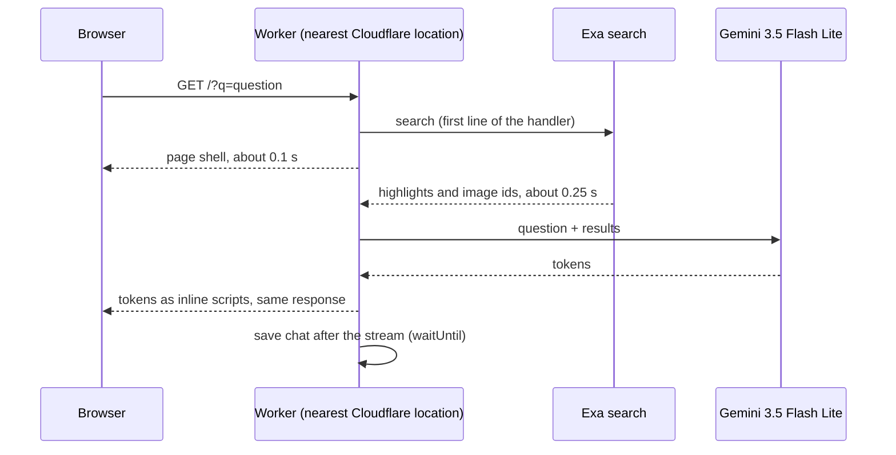

<p align="center"></p>

# QuickAsk

A fast answer engine that runs on Cloudflare Workers. Set it as your browser's
search engine: every search opens a chat that streams an answer from the web,
with sources and, when they help, pictures.

- Streams the first words of an answer in about 1 second.
- Searches the web with [Exa](https://exa.ai) and answers with Gemini 3.5 Flash Lite.
- Each search is a chat. Previous chats are in the sidebar, one history per account.
- The sidebar updates live across tabs and devices over a hibernating WebSocket.
- Search your chats from the sidebar (keywords across titles and messages, SQLite FTS5); the list loads 50 at a time as you scroll.
- Passkey accounts, behind a shared access key.
- Read-only share links that anyone can open, with no account. Links show a rich preview card on X, iMessage and Slack.
- Press ⌘K (Ctrl K) for a new search.
- Answers know your approximate city and local time (from Cloudflare), so local questions like the weather work.
- Each answer ends with three suggested follow-up questions you can tap. Plain URLs and domains in answers are links.
- A faint ⋯ under each answer opens a menu: the raw search results, copy the answer, rerun just that answer with
  the other model, or share just that answer.
- A chat can switch to Gemini 4 Carbon: the last answer is rerun with it, and follow-ups use it. New searches always start on Flash Lite.
- Exa calls are limited to 10 per second for the whole app. Extra searches wait their turn.
- The admin sees live costs in the sidebar and a breakdown by user and day at `/admin`.

## How it stays fast



1. One round trip. The search URL returns the page and the streamed answer in the
   same HTTP response. There is no second request from page JavaScript.
2. The search starts before any other work in the handler.
3. Sign-in checks read no storage. The session is an HMAC-signed cookie.
4. Storage is off the critical path. The sidebar loads in parallel. Chats save after
   the stream ends. Follow-ups send the history the browser already has.
5. The request path is a 20 KB Worker. The WebAuthn library loads only on sign-in routes.
6. The model was picked by measured time to first token, with the same search
   results given to each candidate. See [Benchmarks](#benchmarks).

## Install it on your Cloudflare account

### What you need

| Item | Where to get it |
|---|---|
| A Cloudflare account | [dash.cloudflare.com](https://dash.cloudflare.com/sign-up). The free plan is enough. Open **Workers & Pages** once so the account has a `workers.dev` subdomain. |
| A Cloudflare API token | **My Profile → API Tokens → Create Token → Edit Cloudflare Workers** template. For a custom domain, also give it **Zone → DNS: Edit** on that zone. |
| A Gemini API key | [Google AI Studio](https://aistudio.google.com/apikey) |
| An Exa API key | [dashboard.exa.ai](https://dashboard.exa.ai) |
| [Bun](https://bun.sh) 1.2 or later | `curl -fsSL https://bun.sh/install \| bash` |

### Steps

1. Get the code:

   ```sh
   git clone https://github.com/spullara/quickask.git
   cd quickask/app
   ```

2. Put your keys in `app/.env` (git ignores this file):

   ```sh
   cat > .env <<'EOF'
   CLOUDFLARE_API_TOKEN=your-cloudflare-token
   GEMINI_API_KEY=your-gemini-key
   EXA_API_KEY=your-exa-key
   EOF
   ```

3. Deploy:

   ```sh
   ./deploy.sh
   ```

   The script installs the dependencies, creates an access key and a session secret
   in `app/.env`, deploys with [Alchemy](https://alchemy.run), and prints three lines:

   ```
   App:          https://quick-quick-....workers.dev
   First visit:  https://quick-quick-....workers.dev/?k=<access key>
   Search URL:   https://quick-quick-....workers.dev/?q=%s
   ```

4. Open the **First visit** link once in each browser. It stores the access key in a
   cookie. Then create an account with a passkey.

5. Add the **Search URL** as a search engine (see below).

Give the **First visit** link only to people you want to use your app: each search
costs Gemini and Exa credits.

### Use a custom domain (recommended)

Passkeys are tied to a hostname. Pick the domain before people create accounts.

1. Add the domain to the same Cloudflare account. You can register it there.
2. Add `QUICK_DOMAIN=example.com` to `app/.env`.
3. Run `./deploy.sh` again. Your app is now at `https://example.com`. The
   `workers.dev` address keeps working.

### Add it to your browser

- **Chrome, Arc, Edge:** Settings → Search engine → Manage search engines and site search →
  Site search → Add. URL: `https://<your app>/?q=%s`. Choose **Make default** to use it
  for every search, or give it a shortcut such as `q`.
- **Firefox:** open your app once, then right-click the address bar and choose
  **Add "QuickAsk"**.
- **Safari:** Safari has no custom search engines. Use a redirect extension such as
  "Customize Search Engine" with the same URL.

### Settings

`deploy.sh` reads each value from the environment, then `app/.env`, then `~/.env`.

| Name | Needed | Purpose |
|---|---|---|
| `CLOUDFLARE_API_TOKEN` (or `CF_TOKEN`) | yes | Deploys the Worker. |
| `GEMINI_API_KEY` | yes | Writes the answers. |
| `EXA_API_KEY` | yes | Web search and images. |
| `CLOUDFLARE_ACCOUNT_ID` | no | Needed only when the token can see more than one account. |
| `QUICK_DOMAIN` | no | Custom domain, for example `ask.example.com`. |
| `ADMIN_NAME` | no | Account name that can see costs. The oldest account with this name is the admin. |
| `ACCESS_KEY`, `SESSION_SECRET` | created for you | Change `SESSION_SECRET` to sign everyone out. |

### Keep `app/.alchemy/`

Alchemy keeps its deploy state in `app/.alchemy/` on your machine. Git ignores it.
Without it, Alchemy cannot update or remove what it created. Back it up if you deploy
from more than one machine.

### Remove everything

```sh
./deploy.sh destroy
```

## Test

The end-to-end test runs against your deployed app. It uses a software passkey, so it
needs no browser:

```sh
cd app
python3 -m pip install cryptography
python3 e2e.py https://<your app> "$(grep ^ACCESS_KEY= .env | cut -d= -f2)"
```

It checks the access gate, passkey sign-up and sign-in, streaming, images, separate
histories per account, follow-ups, share links and deletes. It writes `e2e-result.json`.
Each run creates two test accounts (`e2e-alice-<random>`, `e2e-bob-<random>`).

## Project layout

```
app/
  alchemy.run.ts     Cloudflare resources: two Workers and four Durable Objects
  deploy.sh          deploy and destroy
  e2e.py             end-to-end test
  src/worker.ts      routes, Exa search, Gemini streaming, Chats and Shares stores
  src/page.ts        HTML, CSS and browser JavaScript (no build step, no framework)
  src/session.ts     signed session cookies
  src/auth.ts        passkey routes (loaded on demand)
  src/auth-store.ts  users and passkeys
  src/usage.ts       Exa rate limiter and cost ledger
  src/icons.ts       favicons, generated by icons/build.sh from icons/logo.svg
  src/card.ts        share preview image (separate Worker, so its WebAssembly stays off the search path)
bench.py, ttft.py, answer_eval.py, tool_eval.py   model and search benchmarks
```

Storage is four SQLite-backed Durable Objects: one `Chats` object per user, one
`Auth` object for users and passkeys, one `Shares` object for share links, and one
`Usage` object for the Exa rate limit and the cost ledger.

## Benchmarks

The scripts at the repo root are how the stack was chosen. They read API keys from
`~/.env`.

- `bench.py`: total latency of fast models from Anthropic, Google and OpenAI with
  their built-in web search.
- `ttft.py`: time to first token for the fastest candidates.
- `answer_eval.py`: answer accuracy against first-token time when every model gets the
  same Exa results. Better search context fixed accuracy more than a bigger model did.
- `tool_eval.py`: direct search compared with letting the model call search as a tool.
  The tool adds about 0.6 to 0.9 s and did not improve accuracy on the test questions.

## License

MIT. See [LICENSE](LICENSE).
